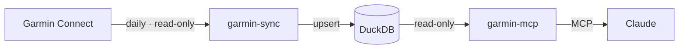

<div align="center">

# Garmin Sync

**Your Garmin data, queryable by Claude.**

A daily sync copies Garmin Connect into a local DuckDB file. A read-only MCP server lets Claude answer
questions about your sleep, recovery and training, and tells it how fresh the data is and what it can't see.

[](https://github.com/yehomak/garmin-sync/actions/workflows/ci.yml)
[](docs/LESSONS.md#second-run-trap-questions)
[](LICENSE)

[](https://www.python.org/)
[](https://modelcontextprotocol.io/)
[](https://claude.com/claude-code)
[](https://duckdb.org/)
[](https://github.com/cyberjunky/python-garminconnect)
[](https://docs.astral.sh/uv/)
[](https://docs.astral.sh/ruff/)

[Quick start](#quick-start) · [Architecture](#architecture) · [Engineering highlights](#engineering-highlights) · [Configuration](#configuration) · [Lessons](docs/LESSONS.md)

</div>

---

## Quick start

No Garmin account needed: the demo command builds 120 days of synthetic data.

```bash
git clone https://github.com/yehomak/garmin-sync.git && cd garmin-sync
uv sync
.venv/bin/garmin-demo
claude mcp add garmin-demo -e GARMIN_DB="$PWD/demo.duckdb" -- "$PWD/.venv/bin/garmin-mcp"
claude "how was my training over the last month?"
```

## Architecture



| Stage | Code | What it does |
|---|---|---|
| Sync | [sync.py](garmin_sync/sync.py), [extract.py](garmin_sync/extract.py) | Calls 7 daily endpoints plus the activity list, maps raw JSON to rows with pure functions, upserts |
| Storage | [schema.sql](garmin_sync/schema.sql) | One local DuckDB file. Defines the tables and documents every column with a comment |
| Serving | [server.py](garmin_sync/server.py), [tools.py](garmin_sync/tools.py) | 9 read-only MCP tools and 1 prompt. Never calls Garmin, never writes |
| Evaluation | [evals/](evals/) | Claude answers questions through the real server and is graded with SQL on synthetic data |

Module map and invariants: [docs/ARCHITECTURE.md](docs/ARCHITECTURE.md). Tool reference:
[docs/MCP.md](docs/MCP.md). Every column: [docs/DATA.md](docs/DATA.md).

## Engineering highlights

### Reliable ingestion

- **Idempotent upserts.** Rows are keyed on date and activity ID with `ON CONFLICT DO UPDATE`, so re-running
  any range is safe. A day where every endpoint failed can't erase existing data.
- **Failure isolation.** Each endpoint call is wrapped on its own. One failure is logged and the rest of the
  day still lands, and the run ends with a summary of partial days.
- **Rate-limit backoff.** HTTP 429 responses retry with backoff. Logins have a 45-second timeout and a
  connectivity pre-check, so a scheduled run can't hang.
- **Late-arriving data.** The default run re-syncs yesterday as well as today, because Garmin finishes
  processing overnight metrics late.
- **In-place migrations.** Schema changes are additive and applied on every run, tested against a database
  with the old schema.

### Safe serving

- **Read-only by construction.** Every tool opens the database read-only. The SQL tool also disables file and
  network access and locks DuckDB's configuration, so model-written SQL can't write, read files or escape.
  Each escape attempt is a test case.
- **No credentials in the server.** Garmin credentials are loaded only by the login step, and a test checks
  that the server process never holds them. Connections close after each call, so the daily sync can write
  while Claude is connected.

### Correct answers, not just correct data

- **Freshness in every response.** Time windows end at the latest synced day, and responses say how old the
  data is.
- **Unknown is not zero.** Workouts logged by hand have no heart rate. Their load stays empty rather than
  zero, and the response says what wasn't measured.
- **One source of truth for meaning.** Column comments in the schema are served to the model and generated
  into the docs. CI fails if a column has no comment or the docs drift.
- **Evals with computed ground truth.** 10 cases, including 3 traps where the literal answer is wrong. Each
  grader must accept a good reply and reject a naive one before it runs. Latest: 10/10 with Claude Opus 5.5
  (raw 9/10; the miss was a grader bug). Details in [docs/LESSONS.md](docs/LESSONS.md).

## Use your own data

```bash
cp .env.example .env          # Garmin email and password
python3 bootstrap.py          # login, backfill, profile. Safe to re-run.
claude mcp add -s user garmin -- "$PWD/.venv/bin/garmin-mcp"
```

Schedule a daily sync: a launchd agent on macOS (it catches up after sleep), cron elsewhere.

```bash
garmin-sync                                   # yesterday + today
garmin-sync --backfill 90                     # last 90 days
garmin-sync --backfill 200 --activities-only  # re-fetch workouts only
garmin-sync --status                          # database summary, no network
```

## Development

```bash
.venv/bin/python -m pytest                            # 50 tests, ~2 s, offline
.venv/bin/ruff check . && .venv/bin/ruff format --check .
.venv/bin/python -m garmin_sync.docs --check          # docs match the schema
.venv/bin/python -m evals.run --check                 # eval cases and graders, no model calls
.venv/bin/python -m evals.run --backend claude-code   # real eval on your Claude login
```

CI runs the first four on every push and pull request.

The repo is set up for Claude Code: [CLAUDE.md](CLAUDE.md) holds the project rules, and [.claude/](.claude/)
holds shared permissions, a format-on-edit hook, slash commands for the common changes, and a
privacy-reviewer agent that checks diffs for personal data before they reach this public repo.

## Configuration

`.env.example`:

```bash
# Garmin Connect login. Used only for the first login, or when the cached session in .garth/ expires.
GARMIN_EMAIL=you@example.com
GARMIN_PASSWORD=yourpassword
```

| Variable | Read from | Required | Purpose |
|---|---|---|---|
| `GARMIN_EMAIL`, `GARMIN_PASSWORD` | `.env`, login step only | First login | Garmin credentials. The MCP server never loads them. |
| `GARMIN_DB` | Shell or MCP client config, **not** `.env` | No | Database path. Defaults to `./garmin.duckdb`. |
| `ANTHROPIC_API_KEY` | Shell | Only for the API eval backend | Messages API access. |

Your data stays on your machine; `garmin.duckdb`, `data/`, `.env` and `.garth/` are gitignored. Claude sees
only what the tools return in a conversation.

## Limits

- Built on [garminconnect](https://github.com/cyberjunky/python-garminconnect), an unofficial wrapper around
  Garmin Connect's internal API. It can break when Garmin changes things. Personal use only.
- Daily granularity, no FIT files. Sleep times are stored in UTC.

## License

[MIT](LICENSE)
