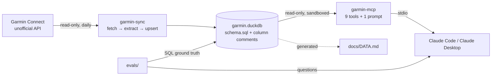

# garmin-sync

**Your Garmin data, queryable by Claude.** A daily sync copies Garmin Connect into a local DuckDB file, and a
read-only MCP server answers questions about sleep, recovery and training, with freshness and caveats in
every response.


**Stack:** Python 3.13 · DuckDB · MCP (`mcp` 2.x) · `garminconnect` · uv · pytest · ruff · GitHub Actions

## Architecture



1. **Sync** (`garmin_sync/sync.py`) calls 7 daily endpoints plus the activity list, maps raw JSON to rows with
   pure functions (`extract.py`), and upserts into DuckDB.
2. **Storage** is a single local DuckDB file. `schema.sql` defines the tables *and* documents every column with
   `COMMENT ON`.
3. **Serving** (`garmin_sync/server.py`) exposes a query layer (`tools.py`) over MCP. It never calls Garmin
   and never writes.
4. **Evaluation** (`evals/`) runs Claude against the real server and grades its answers with SQL computed on a
   synthetic database.

The full module map and invariants are in [docs/ARCHITECTURE.md](docs/ARCHITECTURE.md).

## Engineering highlights

**Reliable ingestion**
- **Idempotent upserts.** `INSERT ... ON CONFLICT (pk) DO UPDATE` on `date` and `activity_id`, so re-running any
  range is safe. A row that holds only its key (every endpoint failed) uses `DO NOTHING` and can't erase
  existing data.
- **Failure isolation per endpoint.** Each of the day's calls is wrapped individually. One failure records an
  error and the rest of the day still lands. The run ends with a summary of partial days.
- **Rate-limit backoff.** 429 and "too many requests" errors retry with linear backoff. Logins are bounded by a
  45 s alarm and a connectivity pre-check, so a scheduled run can't hang.
- **Late-arriving data.** The default run covers yesterday *and* today, because Garmin finishes processing
  overnight metrics late.
- **In-place migrations.** Schema changes are additive (`ALTER TABLE ... ADD COLUMN IF NOT EXISTS`), applied on
  every run, and tested against a database with the old schema.

**Safe serving**
- **Read-only by construction.** Every tool is annotated `readOnlyHint` and opens the database read-only.
  `query_sql` also disables external access and locks configuration, so model-written SQL can't write, read
  files, attach databases or re-enable access. Each escape is a test case.
- **No credentials in the server.** `.env` is loaded only by the auth modules; a test asserts the server
  process never holds the Garmin password. Connections are closed per call, so the daily sync can write while
  Claude is connected.

**Correct answers, not just correct data**
- **Freshness in every response.** Windows end at the latest synced day, and responses carry `data_through`,
  `stale_days` and a warning.
- **Unknown is not zero.** Manually logged workouts have no heart rate. Their load stays `null`, and `notes`
  say what wasn't measured.
- **One source of truth for meaning.** Column comments feed `describe_schema` (for the model) and
  `docs/DATA.md` (for people). CI fails if a column has no comment or the doc drifts.
- **Evals with computed ground truth.** 10 cases, including 3 traps where the literal answer is wrong. Graders
  must accept a good reply and reject a naive one before any run. Latest: 10/10 with Claude Opus 5.5 (raw 9/10;
  the miss was a grader bug). See [docs/LESSONS.md](docs/LESSONS.md).

## Local development

Requires Python 3.12+ and [uv](https://docs.astral.sh/uv/). No Docker: everything is one local file and one
process.

```bash
git clone https://github.com/yehomak/garmin-sync.git && cd garmin-sync
uv sync                                   # creates .venv, installs the package + dev tools

# Try it with synthetic data (no Garmin account)
.venv/bin/garmin-demo                     # → demo.duckdb, 120 days
claude mcp add garmin-demo -e GARMIN_DB="$PWD/demo.duckdb" -- "$PWD/.venv/bin/garmin-mcp"

# Use your own data
cp .env.example .env                      # fill in Garmin credentials
python3 bootstrap.py                      # login, backfill, profile. Safe to re-run.
claude mcp add -s user garmin -- "$PWD/.venv/bin/garmin-mcp"
```

```bash
garmin-sync                               # yesterday + today (schedule daily: launchd on macOS, cron elsewhere)
garmin-sync --backfill 90                 # last N days
garmin-sync --backfill 200 --activities-only
garmin-sync --status                      # DB summary, no network
```

```bash
.venv/bin/python -m pytest                # 50 tests, ~2 s, offline
.venv/bin/ruff check . && .venv/bin/ruff format --check .
.venv/bin/python -m garmin_sync.docs --check
.venv/bin/python -m evals.run --check     # validate cases and graders, no model calls
.venv/bin/python -m evals.run --backend claude-code   # real eval on your Claude login
```

CI runs the first four on every push and PR.

## Configuration

`.env.example`:

```bash
# Garmin Connect login. Used only for the first login, or when the cached session in .garth/ expires.
GARMIN_EMAIL=you@example.com
GARMIN_PASSWORD=yourpassword
```

| Variable | Where it's read | Required | Purpose |
|---|---|---|---|
| `GARMIN_EMAIL`, `GARMIN_PASSWORD` | `.env`, auth only | First login | Garmin credentials. Never loaded by the MCP server. |
| `GARMIN_DB` | Process environment or MCP client config (**not** `.env`) | No | Database path. Defaults to `./garmin.duckdb`. |
| `ANTHROPIC_API_KEY` | Process environment | Only for `evals.run --backend api` | Messages API eval backend. |

`garmin.duckdb`, `data/`, `.env`, `.garth/` and `evals/results/` are gitignored.

## Working on it with Claude Code

[`CLAUDE.md`](CLAUDE.md) holds the project rules. [`.claude/`](.claude/) holds shared permissions, a
format-on-edit hook, the `/verify`, `/add-field`, `/add-tool`, `/audit-data` and `/commit-push-pr` commands,
and a `privacy-reviewer` agent that checks diffs for personal data before they reach this public repo.

## Limits

- Built on [`garminconnect`](https://github.com/cyberjunky/python-garminconnect), an unofficial wrapper around
  Garmin Connect's internal API. It can break when Garmin changes things. Personal use only.
- Daily granularity. No FIT files. Sleep times are stored in UTC.

MIT
